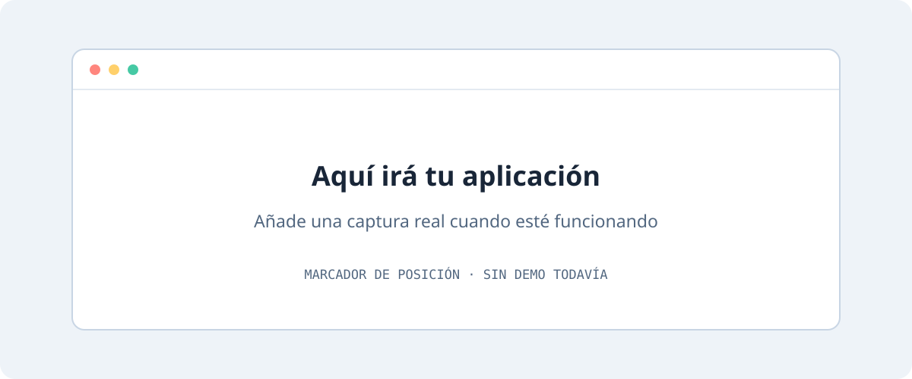

# 🧩 Nombre del proyecto

**¿Vas a empezar un proyecto?** Usa **Use this template → Create a new repository** y sigue la [guía para adaptar la plantilla](docs/USAR-PLANTILLA.md).

> **Explica en una frase qué problema resuelve y para quién.** Sustituye este texto al crear tu proyecto.

<a href="#vista-previa">Vista previa</a> · <a href="#-inicio-rápido">Instalación</a> · <a href="docs/USO.md">Guía de uso</a> · <a href="docs/ROADMAP.md">Hoja de ruta</a>

| Estado | Plataforma | Tecnología | Licencia |
| :--- | :--- | :--- | :--- |
| 🟡 En preparación | Por definir | Por definir | Pendiente de elegir |

## 🎯 Qué hace

Describe el resultado que consigue el usuario, sin prometer funciones que aún no existen.

- **Función principal:** sustituir por una función real.
- **Segunda función:** sustituir por una función real.
- **Privacidad:** explicar dónde se procesan y guardan los datos.

## 🖼️ Vista previa

*Esta imagen es un marcador de posición: todavía no es una captura de una aplicación.*

Al tener el proyecto funcionando, guarda una captura sin datos personales en `docs/assets/captura.png` y cambia el enlace anterior. Añade un enlace a la demo solo si existe.

## 🚀 Inicio rápido

1. Revisa los [requisitos y pasos de instalación](docs/INSTALACION.md).
2. Configura únicamente las variables que necesite el proyecto.
3. Sigue la [guía de uso](docs/USO.md).

**Esta plantilla no contiene una aplicación ni comandos de instalación ficticios.** Documenta aquí los comandos exactos después de elegir la tecnología y comprobarlos.

## 🗂️ Organización

| Ruta | Contenido |
| :--- | :--- |
| `src/` | Código de la aplicación |
| `tests/` | Pruebas relevantes cuando sean necesarias |
| `docs/` | Instalación, uso y planificación |
| `docs/assets/` | Cabecera y capturas |
| `scripts/` | Herramientas de desarrollo o mantenimiento |
| `.github/` | Formularios de incidencias y plantilla de cambios |
| `AGENTS.md` / `CLAUDE.md` | Instrucciones para asistentes de programación |

Adapta estas carpetas al proyecto; elimina las vacías que no necesites.

## 🔐 Datos y seguridad

Explica permisos, servicios externos, copias de seguridad y límites. Nunca publiques claves, contraseñas, tickets ni datos personales. Consulta [SECURITY.md](SECURITY.md).

## 🤝 Participación

¿Hay un error o una idea? Abre una incidencia con el formulario correspondiente. Lee [CONTRIBUTING.md](CONTRIBUTING.md) antes de proponer cambios.

## 📋 Evolución

Consulta la [hoja de ruta](docs/ROADMAP.md) y el [registro de cambios](CHANGELOG.md).

## ⚖️ Licencia

La licencia del nuevo proyecto está **pendiente de elegir**. Consulta [la guía de licencia](docs/LICENCIA.md). Una firma de autoría no concede por sí sola permiso de uso o redistribución. Conserva los avisos y licencias del código de terceros.

---

Creado por **Asier Carballés** · Diseño y desarrollo · © 2026
